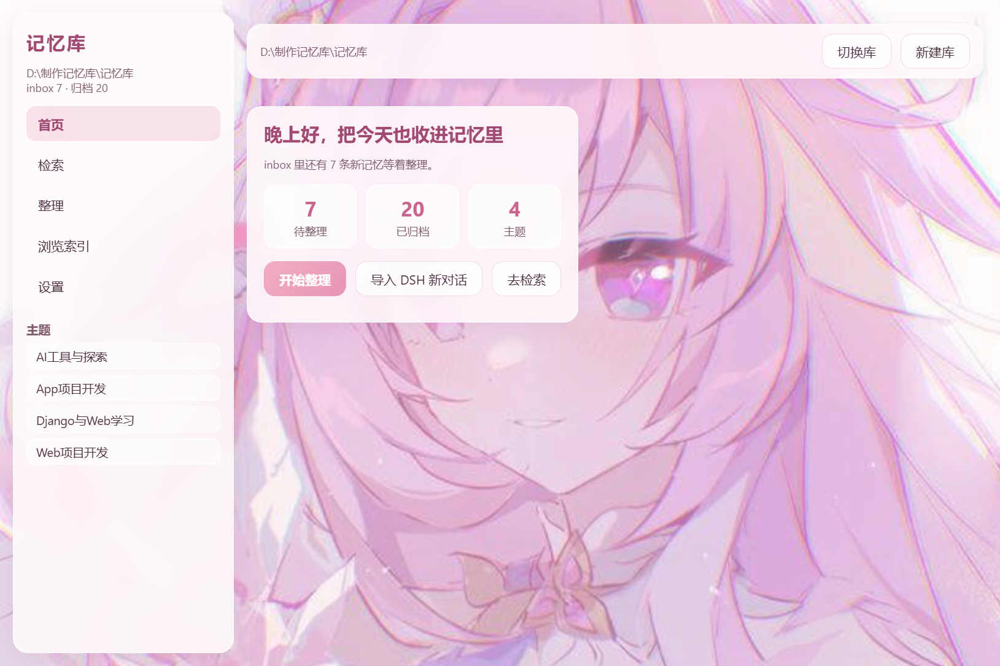
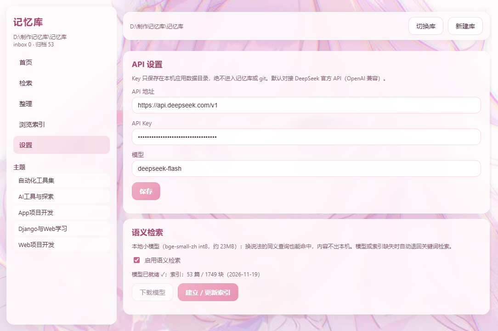

# 记忆库 · Memory Library

本地优先的个人记忆库桌面应用：纯 Markdown 存储 + AI 整理 + 关键词与语义混合检索 + MCP 接口。人和 AI agent 共用同一个库——你负责沉淀，AI 负责整理，agent 通过协议接口认识你。

A local-first personal memory library: plain Markdown on disk, AI-assisted organizing, hybrid keyword + semantic search, and an MCP server so any AI agent can read and extend it.



## 功能

- **AI 整理**：把文件、笔记、AI 对话丢进 `inbox`，一键分类归档、生成摘要与标签，重建分层索引；**原文零改动**，索引是可再生的衍生品。文件夹可整体入库（原件原样保留在 `archive/files/`）。
- **混合检索**：关键词（字段加权）+ 本地语义向量（bge-small-zh int8，ONNX 纯 CPU）RRF 融合排序。换说法的同义查询也能命中；模型未下载时自动退回纯关键词，搜索永远可用。
- **本地优先**：库是纯文件，配置、模型、向量缓存全部留在本机；API Key 只存在本机应用数据目录，绝不入库。
- **MCP 接口**：独立 stdio 服务，提供 `memory_overview` / `memory_search` / `memory_read` / `memory_add` 四个工具，Qoder、DSH 等任意 MCP 客户端可接入。
- **桌面应用**：Electron + NSIS 安装版（自选安装位置、桌面/开始菜单快捷方式），启动自动连接上次的记忆库；樱粉玻璃主题，动效安静克制（可读性优先，尊重系统"减少动态效果"）。



## 核心设计

1. **库是本体，客户端是壳**：记忆库是纯文件。桌面界面、MCP 接口、裸文件浏览是三个平等客户端，任何一个坏了，库都完好可用。
2. **原文与索引分离**：原始文件是唯一事实来源；摘要、标签、索引均可重建、可回滚。
3. **分层索引**：总索引（用户画像 + 主题地图 + 最近动态）→ 主题子索引（摘要 + 关键词 + 原文链接）→ 原文。agent 先读总索引，再按需下钻。

## 快速开始

环境：Windows 10/11，Node.js ≥ 24。

```bash
npm install
npm start        # 开发模式运行
npm test         # 全量测试（含语义模型缺失时自动跳过真模型用例）
npm run dist     # 打包 NSIS 安装版到 release/
```

首次使用：打开应用 → 「新建记忆库」选一个空文件夹 → 设置页填入 OpenAI 兼容的 API（默认 DeepSeek）→ 把文件或文件夹放进库内 `inbox/` → 「整理」。

语义检索（可选）：设置页点「下载模型」（约 23MB，一次性）→ 「建立 / 更新索引」。首次建索引视库大小需数分钟，可随时停止、之后续建；日常整理后会自动增量更新。

## 目录结构

```
app/            Electron 主进程 + 预加载桥 + 渲染层（界面）
core/           纯 Node 模块：扫描 / 整理 / 索引 / 检索 / 向量 / 分词 / 配置
mcp/            MCP stdio 服务与工具层（协议无关的纯函数可单测）
scripts/        会话导出（DSH）、模型下载、图标生成、打包与冒烟
build/          应用图标
docs/           截图等文档资产
```

## MCP 接入

服务进程：`node mcp/server.mjs [记忆库路径]`（也可用环境变量 `MEMORY_LIBRARY_DIR` 指定；缺省为仓库内 `记忆库/`）。

通用 MCP 客户端配置：

```json
{
  "mcpServers": {
    "memory": {
      "command": "node",
      "args": ["<本仓库路径>/mcp/server.mjs", "<你的记忆库路径>"]
    }
  }
}
```

工具名会带前缀（如 `mcp__memory__memory_search`）。建议在给 agent 的系统提示里加一句："对话开始时先调用 memory_overview 读总索引认识库主人。"

## 语义检索实现

- 模型：[bge-small-zh-v1.5](https://huggingface.co/Xenova/bge-small-zh-v1.5) int8 量化（ONNX Runtime，纯 CPU，推理线程限 2，会话闲置 60 秒释放内存），自实现 BERT WordPiece 分词，不依赖 transformers.js。
- 模型文件存本机应用数据目录（Windows: `%APPDATA%/记忆库/models`），客户端与 MCP 共享；`scripts/download-model.mjs` 从 hf-mirror 优先下载、huggingface 兜底。
- 向量索引是派生缓存（`<库>/.cache/vectors.json`），按内容哈希增量更新，每文档落盘 checkpoint，可断点续建。
- 余弦相似度下限 0.45（真实语料校准：相关命中 ≥0.58、无关 ≤0.41）。

## 数据与隐私

- 记忆库目录默认**不进入本仓库**（`.gitignore`），请把它当作你的私人数据。
- AI 整理会把待整理文档的正文发送给你配置的 API（默认 DeepSeek）；检索、索引、模型推理全部本地完成。
- API Key 仅存本机 `%APPDATA%/记忆库/config.local.json`（已忽略，不入库）。
- 本仓库不包含任何个人记忆库内容；截图中的主题名称仅为界面示意。

## 许可证

[MIT](LICENSE)